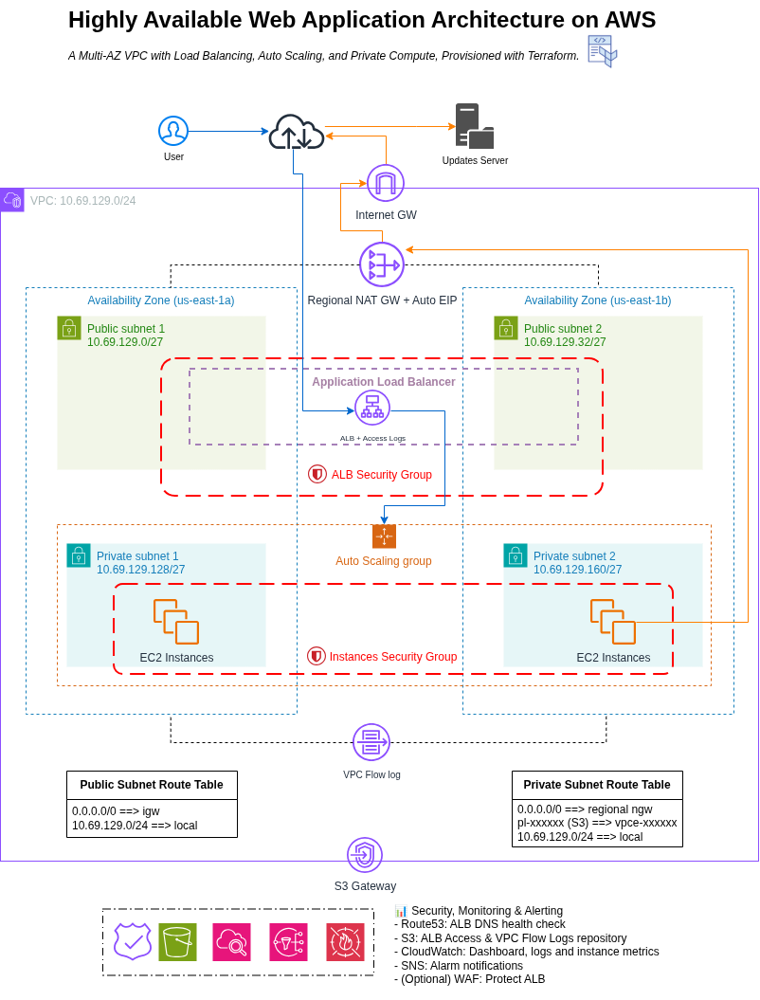

# AWS HA Web App: Terraform Capstone

Terraform deploys an HTTP web app across multiple Availability Zones (AZs),
demonstrating modular networking, load balancing, Auto Scaling, and monitoring.



The diagram shows two AZs; the configuration accepts two to four. HTTPS is not
configured.

## Design decisions

| Decision | Rationale and trade-off |
| --- | --- |
| Regional NAT gateway | Simplifies multi-AZ outbound connectivity but incurs charges. |
| Fixed subnet offsets | Predictably separates public and private ranges. |
| Module-owned log buckets | Keeps ALB and VPC logs with their resource owners. |
| Optional WAF | Defaults on outside dev; managed rules add cost. |
| Route 53 alarm in `us-east-1` | Uses the health-check metrics region. |
| SSM instead of SSH | Avoids inbound SSH and key management; requires IAM permissions. |
| One-way module dependencies | Keeps infrastructure dependencies acyclic. |
| Separate S3 backend | State bucket lives outside this stack so destroy can’t delete it. |

## Repository

```text
docs/                 Architecture, dependency diagram, and selected evidence
envs/dev/             Root module and deployment instructions
modules/network/      VPC, subnets, routes, NAT, and S3 endpoint
modules/alb/          Load balancer, access logs, and optional WAF
modules/compute/      Launch template, Auto Scaling, and instance role
modules/observability/ Flow logs, health check, alarms, and dashboard
validations/dev/env/  Recorded validation evidence
```

See the [module dependency diagram](docs/terraform_modules_dependencies.png)
and [engineering notes](docs/engineering-notes.md).

## Deploy

Requires Terraform >= 1.11, AWS credentials with appropriate permissions, and a
separately managed S3 state bucket. Configure `AWS_PROFILE`, `TF_VAR_emails_list`,
inputs, and the backend as described in [envs/dev/README.md](envs/dev/README.md).

```sh
cd envs/dev
terraform init -backend-config="bucket=<your-state-bucket>" \
  -backend-config="key=<your-state-key>" \
  -backend-config="region=<your-state-bucket-region>"
terraform fmt -check -recursive ../..
terraform validate
terraform plan
terraform apply
terraform destroy
```

Confirm SNS subscriptions before testing. `destroy` leaves the state bucket.

## Validation evidence

A dev deployment successfully provisioned and destroyed 54 Terraform-managed
resources. Manual testing demonstrated multi-AZ load balancing, automatic
instance replacement after application and instance failures, WAF request
blocking, CloudWatch alarm and recovery notifications, and S3 log delivery.

- [Dashboard](docs/dashboard-validation.png): requests and healthy-target dips from an earlier run.
- [Alarm notification](docs/alarm-notification.png): healthy targets below minimum.
- [Recovery notification](docs/alarm-recovery.png): alarm returned to OK.

See [validation results](docs/validation-results.md) for the test overview and
[validation artifacts](validations/dev/env/) for the full recorded logs.

## Cost and future work

EC2, ALB, regional NAT, and public IPv4 incur time-based charges. Data
processing, logging, storage, monitoring, WAF, and Route 53 may also incur
charges. Destroy after use and check for remaining resources.

Future work: CI/CD with OIDC, Terraform tests, WAF logging, ALB HTTPS, and
additional environments. The external check monitors the ALB's HTTP endpoint,
not a custom domain or HTTPS journey.

## License

This project is licensed under the [MIT License](LICENSE).
